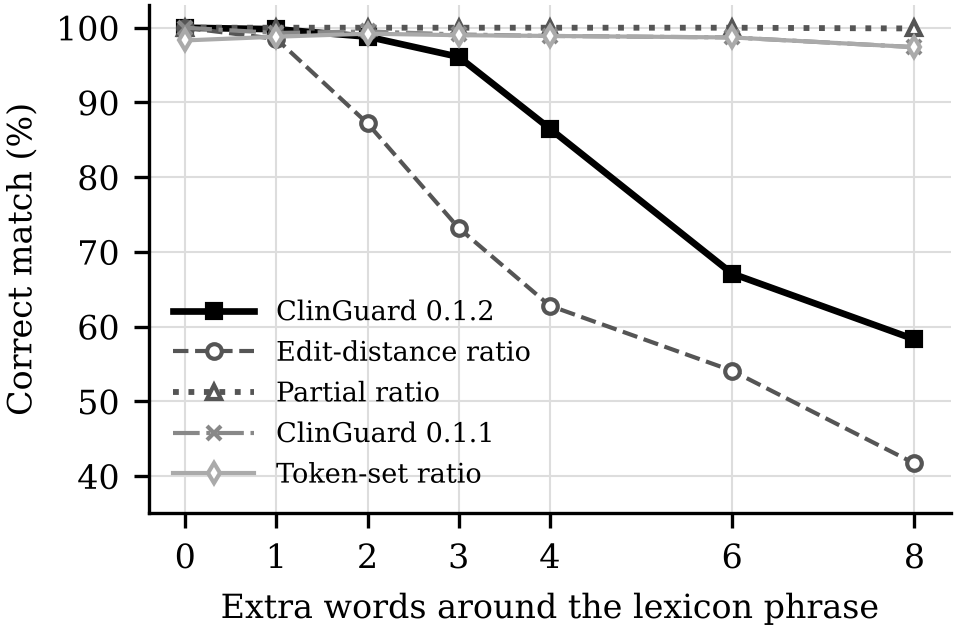
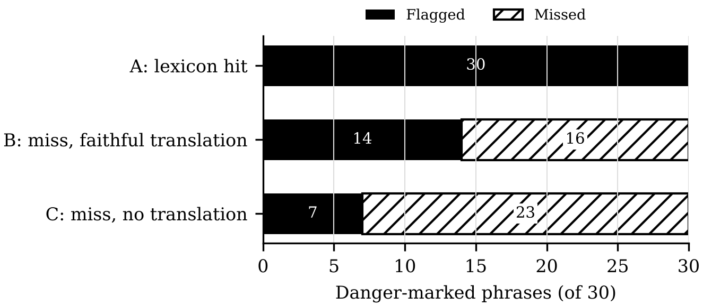
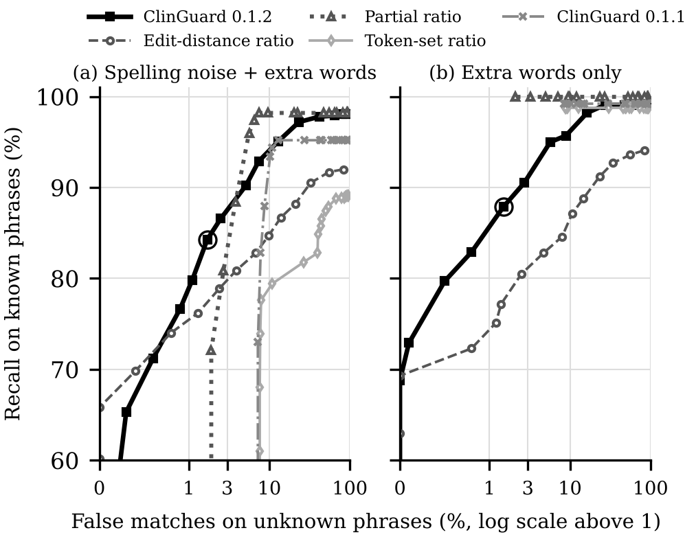

# Experiments

Everything needed to regenerate the technical results for ClinGuard: frozen test cases,
scoring scripts, one configuration file, result tables and figures.

    pip install rapidfuzz matplotlib
    python experiments/run_all.py         # tables  -> experiments/results/
    python experiments/make_figures.py    # figures -> experiments/figures/
    python experiments/make_cases.py --check   # confirms the frozen cases can be regenerated

All tests run on text and are deterministic. **They do not measure clinical accuracy.**
Read [LIMITATIONS.md](LIMITATIONS.md) with the results; it includes the negative findings.

## Tests

| Test | Question | Cases |
|---|---|---|
| T1 | When a phrase is not in the lexicon, is it matched to a wrong clinical term? | Each of the 60 entries, held out in turn |
| T2 | Are misspelled, unmarked or run-together variants still recognised? | 178 frozen variants |
| T3 | Is a known phrase recognised inside freer speech (0 to 8 extra words)? | 8,400 frozen utterances |
| T4 | How many danger signs do the rules flag on a lexicon hit, and on a miss? | The 60 entries, 30 danger-marked |
| T5 | With two complaints in one utterance, is the danger sign found? | 1,200 frozen utterances |
| T6 | At a fixed false-match rate on unknown phrases, how many known phrases are recognised? Each scorer gets its own threshold, chosen in-sample and on held-out entries (50 splits) | 1,200 noisy and 1,200 clean utterances, each scored as known and unknown |
| T7 | Do the danger rules tell an active complaint from a negated, past or hypothetical one? | 40 hand-written English meanings (labels not yet clinically reviewed) |

Scorers compared: edit-distance ratio, token-set ratio, partial ratio, ClinGuard 0.1.1 and
ClinGuard 0.1.2, plus an ablation of the two matching safeguards and a threshold sweep.

## Headline results (ClinGuard 0.1.2, threshold 0.75)

Full tables: [results/summary.md](results/summary.md).

| Test | Result |
|---|---|
| T1 | 2 wrong-term matches of 60 (partial ratio 33, ClinGuard 0.1.1 32, edit-distance ratio 3) |
| T2 | 177 of 178 variants recalled |
| T3 | 98.8% correct with 2 extra words, 86.5% with 4, 67.1% with 6 (edit-distance ratio: 87.2%, 62.8%, 54.1%) |
| T4 | 30 of 30 flagged on a lexicon hit; **14 of 30 on a miss with a faithful translation; 7 of 30 with none.** No false alarms |
| T5 | Danger flagged in 513 of 600 utterances, in either order; 1 matched a third entry with the same complaint under another label |
| T6 | With spelling noise, highest recall at 1% and 3% false matches (76.6%, 86.6%); a partial-ratio matcher is ahead at 5% (88.4%). **On clean text, a partial-ratio matcher at threshold 0.975 beats ClinGuard (100% against 90.5% at 3%)**. Held-out tuning gives the same pattern, with wide variation between splits |
| T7 | All 10 active complaints flagged, **but also all 30 negated, past and hypothetical mentions** |

## Layout

| Path | Contents |
|---|---|
| `config.json` | Threshold, sweep values, seeds and case counts |
| `data/` | Frozen lexicon and danger rules |
| `cases/t7_negation_english.csv` | Hand-written (not generated) negation sentences for T7 |
| `cases/` | Frozen synthetic cases (CSV), one row per test utterance |
| `common.py` | Scorers, ablation variants and statistics |
| `make_cases.py` | Regenerates or verifies the frozen cases |
| `run_all.py` | Scores every test; writes `results/*.csv` and `results/summary.md` |
| `t6_risk_coverage.py` | T6 recall against false matches, in-sample and held-out (called by `run_all.py`) |
| `t7_negation.py` | T7 negation test (called by `run_all.py`) |
| `make_figures.py` | Draws `figures/*` from the result tables only |
| `results/`, `figures/` | Committed outputs, so changes show up in version control |

## Data

`data/` is a frozen copy of the lexicon and danger rules of
[BeaGrace Health](https://github.com/shalini-2020/beagrace-health) at commit `cf4f80d`
(11 November 2026), curated by nurses and native speakers of the BeaGrace Foundation. The
danger rules are an initial list awaiting clinical approval. SHA-256 prefixes are printed
at the top of `results/summary.md`.
